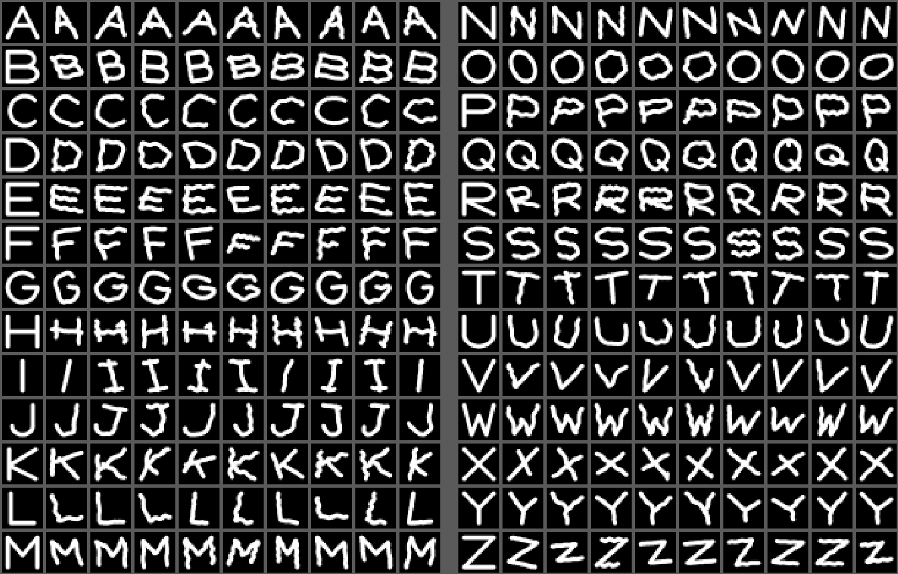

# Air Writing ✍️

Écrire dans l'air avec son doigt et une webcam : l'index est suivi en temps réel, son mouvement devient un tracé, puis un modèle d'apprentissage automatique reconnaît la lettre dessinée (A–Z, majuscules).

## Pipeline

```
Webcam (OpenCV) → main (MediaPipe, 21 points) → geste (écrire / lever / effacer)
→ tracé du bout de l'index (lissé) → image 28×28 normalisée → HOG + pixels → SVM (scikit-learn) → lettre
```

- **Suivi de la main** : MediaPipe Hand Landmarker. Un doigt est considéré tendu si son bout est nettement plus loin du poignet que son articulation du milieu, ce qui marche quelle que soit l'orientation de la main.
- **Prétraitement** : la lettre est recadrée, mise à l'échelle en gardant ses proportions, centrée, puis redessinée avec une épaisseur fixe. Une lettre petite ou grande, rapide ou lente, donne donc la même image.
- **Classification** : descripteurs HOG + pixels 14×14, puis un SVM RBF calibré pour donner des probabilités (top 3 affiché).
- **Données d'entraînement** : des tracés synthétiques générés à partir de modèles de lettres, avec des déformations qui imitent un doigt dans l'air (rotation, italique, tremblement, ondulation, bouts de trait parasites quand on lève le doigt), puis **tes vrais gestes** enregistrés avec le mode collecte.



## Installation

Python 3.10 à 3.13.

```bash
pip install -r requirements.txt
```

Le modèle de main MediaPipe (`hand_landmarker.task`) se télécharge tout seul au premier lancement.

## Utilisation

```bash
python entrainer.py          # 1. entraîne le classifieur (~30 s)
python air_writing.py        # 2. écris dans l'air !
```

| Geste | Action |
|---|---|
| Index seul levé | écrire |
| Index + majeur levés | lever le stylo (pour la barre du A, du T...) |
| Main ouverte, maintenue | effacer le tracé |
| Pause d'environ 1 s | la lettre est reconnue et ajoutée au texte |

Touches : `espace` reconnaître tout de suite, `c` effacer le tracé, `x` supprimer la dernière lettre, `q` ou `Échap` quitter.

## Collecter de vrais gestes et évaluer

```bash
python air_writing.py --collecte                  # toutes les lettres, 10 gestes chacune
python air_writing.py --collecte --lettres AEIOU --par-lettre 20
python entrainer.py                               # réentraîne avec tes gestes
```

L'application demande les lettres une par une, en alternant (A, B, C... puis on recommence) pour avoir des gestes plus variés. `espace` enregistre le tracé, `c` recommence, `n` passe à une autre lettre. On peut arrêter et reprendre plus tard : les gestes s'accumulent dans `mes_gestes/` (tracé brut en JSON + image 28×28 en PNG).

`entrainer.py` affiche alors trois résultats :

1. la précision sur des tracés synthétiques jamais vus (optimiste) ;
2. la précision du modèle **synthétique seul** sur tes vrais gestes, c'est le vrai test ;
3. la précision après ajout de 70 % de tes gestes, mesurée sur les 30 % restants.

Il affiche aussi la précision par lettre et les confusions les plus fréquentes (par ex. `U->V`).

## Limites

- Prototype : la reconnaissance dépend du tracé, de l'éclairage et du fond.
- Majuscules uniquement, une lettre à la fois.
- Les données synthétiques ne remplacent pas de vrais gestes de plusieurs personnes.

## Fichiers

| Fichier | Rôle |
|---|---|
| `air_writing.py` | application temps réel + mode collecte |
| `entrainer.py` | génération des données, entraînement, évaluation |
| `pretraitement.py` | tracé → image → features, modèles de lettres, augmentation |

## Problèmes fréquents

- **La webcam ne s'ouvre pas** : `python air_writing.py --camera 1`
- **Erreur avec `cv2`** : MediaPipe installe déjà `opencv-contrib-python`. Si tu as aussi `opencv-python`, désinstalle-le : `pip uninstall opencv-python`, puis `pip install --force-reinstall opencv-contrib-python`.
- **Le modèle de main ne se télécharge pas** : récupère-le à la main [ici](https://storage.googleapis.com/mediapipe-models/hand_landmarker/hand_landmarker/float16/latest/hand_landmarker.task) et place-le dans le dossier du projet.
- **Tracé qui tremble** : baisse `LISSAGE` en haut de `air_writing.py` (0.3 par exemple).
